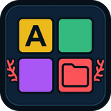

<p align="center">
  
</p>

# Coral

[](https://github.com/UberMetroid/coral/actions/workflows/ci.yml)
[](https://github.com/UberMetroid/coral/releases/latest)
[](LICENSE)
[](https://ubermetroid.github.io/tuition-not-coffee)
[](https://github.com/UberMetroid/coral)

**Coral** (`coral@ubermetroid.github.io`) is a fast, zero-subprocess, Wayland-native **Alphabetical Application Grid & Smart Auto-Folder Organizer** for **GNOME Shell 45–50**. It keeps your GNOME Overview App Grid and every App Folder in crisp alphabetical order, automatically groups loose applications into labeled category folders whenever your icons would spill onto an overflow page, and adds Kelp/Reef accent borders to open App Folder popups.

Derived from [Alphabetical App Grid](https://github.com/stuarthayhurst/alphabetical-grid-extension) (`AlphabeticalAppGrid@stuarthayhurst` by Stuart Hayhurst) — hardened against module-scope compositor access (`Main.overview._overview._controls`), upgraded with **Smart Auto-Group Overflow Prevention**, pinned-favorites grid display, and App Folder accent styling, and engineered under the same strict [`AGENTS.md`](AGENTS.md) Page Rule and EGO standards as [**Kelp**](https://github.com/UberMetroid/kelp), [**Reef**](https://github.com/UberMetroid/reef), and [**Shoal**](https://github.com/UberMetroid/shoal). Official project artwork is archived in [`brand/`](brand/) (`icon-512.png`, `icon-256.png`, `icon-160.png`, `favicon-64.png`).

> 🎓 **Support Coral — [Tuition, Not Coffee — Help send my daughter to college](https://ubermetroid.github.io/tuition-not-coffee)** · 🌐 [**Project Website (`ubermetroid.github.io/coral`)**](https://ubermetroid.github.io/coral/) · ⭐ [**Star UberMetroid/coral on GitHub**](https://github.com/UberMetroid/coral)

---

## Designed to Pair with Kelp, Reef & Shoal (and Standalone GNOME)

| Feature | Default | Why It Matters |
| :--- | :--- | :--- |
| **Smart Auto-Group Overflow Prevention** | **Active (`overflow-only`)** | Whenever your installed apps + folders would exceed a single App Grid page (`itemsPerPage`, default 24) and create an overflow page, Coral inspects Freedesktop `.desktop` `Categories` and automatically groups enough apps into labeled folders (*Games*, *Office*, *Accessories*, *Utilities*, *System*, *Development*, *Media & Graphics*, *Internet & Social*, *Science & Docs*) to keep your entire App Grid on Page 1. |
| **Alphabetical App Grid & Folder Contents** | **Active (`A -> Z`)** | Automatically sorts both the top-level App Grid and the icons inside every App Folder (`org.gnome.desktop.app-folders`), with instant `Z -> A` reverse mode and configurable folder placement (`Alphabetical`, `Start of Grid`, `End of Grid`). |
| **1-Click Unpack Auto-Created Folders** | **Built-in** | Want to dissolve Coral's auto-created `coral-*` category folders back into loose icons? Click **Unpack Auto-Groups** in Coral Preferences anytime. |
| **Show Pinned Favorites in App Grid** | **Configurable** | Optionally keep your pinned dock/dash favorite applications visible in their alphabetical spot inside the main App Grid. |
| **Kelp & Reef App Folder Accent Border** | **Coral Red (`2px`, `24px` radius)** | Open App Folder popups feature a crisp accent border with 1-click presets (*Gruvbox Amber*, *Kelp Emerald*, *Ocean Cyan*, *Coral Red*) matching **Kelp** tiled windows and the **Reef** dock pill. |

---

## Quick Install

Download `coral@ubermetroid.github.io.shell-extension.zip` from [**GitHub Releases (`v1.2.0`)**](https://github.com/UberMetroid/coral/releases/latest):

```bash
gnome-extensions install --force coral@ubermetroid.github.io.shell-extension.zip
gnome-extensions enable coral@ubermetroid.github.io
```

Open the 3-tab Libadwaita Preferences window anytime by running:

```bash
gnome-extensions prefs coral@ubermetroid.github.io
```

---

## 3-Tab Libadwaita Settings & About Window

| Tab | Controls Included |
| :--- | :--- |
| **1. Grid & Auto-Groups** | **Smart Auto-Group to Prevent Overflow Page** toggle, **Auto-Group Strategy** (`Only When Needed to Stop Overflow Page` vs. `Always Group All Apps by Category`), **Target Icons Per Page** (`12–48`, default `24`), **Unpack Auto-Created Category Folders**, **Folder Placement** (`Alphabetical`, `Start of Grid`, `End of Grid`), **Sort Folder Contents Alphabetically** toggle, **Reverse Order (`Z -> A`)** toggle, **Show Pinned Favorites in App Grid** toggle, **Always Open App Grid on First Page** toggle, and **Reset to Coral Defaults**. |
| **2. Folder Styling** | **Show App Folder Accent Border** toggle, **Accent Border Color** picker, **Quick Color Presets** (*Gruvbox Amber*, *Kelp Emerald*, *Ocean Cyan*, *Coral Red*), **Border Width** (`0–8 px`, default `2 px`), and **Border Corner Radius** (`0–36 px`, default `24 px`). |
| **3. About & Support** | Release version (`v1.2.0`), `GPL-3.0-or-later` license & Stuart Hayhurst (`Alphabetical App Grid`) attribution, **Star Coral on GitHub**, **Tuition, Not Coffee — Help send my daughter to college**, **Project Website**, and **Report an Issue**. |

---

## Multi-Distro & `systemd` Integration

Coral works out of the box across **GNOME Shell 45, 46, 47, 48, 49, and 50** on **Fedora, Debian, Ubuntu, Arch Linux, openSUSE, and NixOS**:

- **`systemd-logind` Lock & Suspend Lifecycle**: Cleanly restores `AppDisplay.AppDisplay.prototype` via `InjectionManager.clear()`, coalesces rapid grid updates while canceling any pending `[coral] reorder-grid` timer on teardown, disconnects all `connectObject` listeners, releases owned references, and unloads the folder-dialog stylesheet on screen lock or disable.
- **Universal `.desktop` Category & User `excluded-apps` Support**: Uses `Shell.AppSystem.get_default()`, `GioUnix.DesktopAppInfo.get_categories()`, and `org.gnome.desktop.app-folders` (including user `excluded-apps` respect) so native packages (`.rpm`, `.deb`, `pacman`), Flatpaks, Snaps, Steam games, and AppImages sort and auto-group identically across all distributions.
- **Zero Subprocesses or Telemetry**: Never spawns external processes (`GLib.spawn_*` / `Gio.Subprocess`) or makes network calls.

---

## Verification & Development

Coral enforces strict architectural invariants (`16..=256` lines per `.js` file, `<= 200` chars per line, `<= 8` visible entries per directory, zero banned filenames, and strict process-boundary separation between `prefs.js` and compositor modules) verified by `tests/verify.js`:

```bash
xmllint --noout extension/schemas/*.xml
glib-compile-schemas --strict --dry-run extension/schemas
gjs -m tests/verify.js
gnome-extensions pack extension --force --out-dir=dist \
  --schema=schemas/org.gnome.shell.extensions.coral.gschema.xml \
  --extra-source=grid --extra-source=ui
pipx run shexli dist/coral@ubermetroid.github.io.shell-extension.zip
```

---

## 🎓 Sponsor / Support — Tuition, Not Coffee

If Coral, Shoal, Reef, and Kelp improve your daily Linux workflow, please consider supporting development:

- 🎓 **Sponsor / Donate**: [**Tuition, Not Coffee — Help send my daughter to college**](https://ubermetroid.github.io/tuition-not-coffee)
- 🌐 **Project Website**: [**ubermetroid.github.io/coral**](https://ubermetroid.github.io/coral/)
- ⭐ **Star on GitHub**: [**github.com/UberMetroid/coral**](https://github.com/UberMetroid/coral)

---

## License & Attribution

Released under the [GNU General Public License v3.0 or later](LICENSE) (`GPL-3.0-or-later`).

Derived from [Alphabetical App Grid](https://github.com/stuarthayhurst/alphabetical-grid-extension) (`AlphabeticalAppGrid@stuarthayhurst`, `GPL-3.0-or-later`), Copyright (C) Stuart Hayhurst `<stuart.a.hayhurst@gmail.com>` and contributors.
